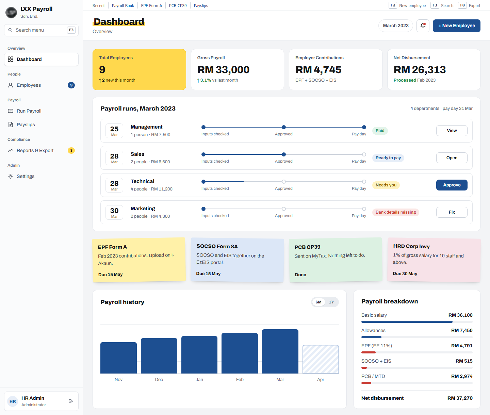
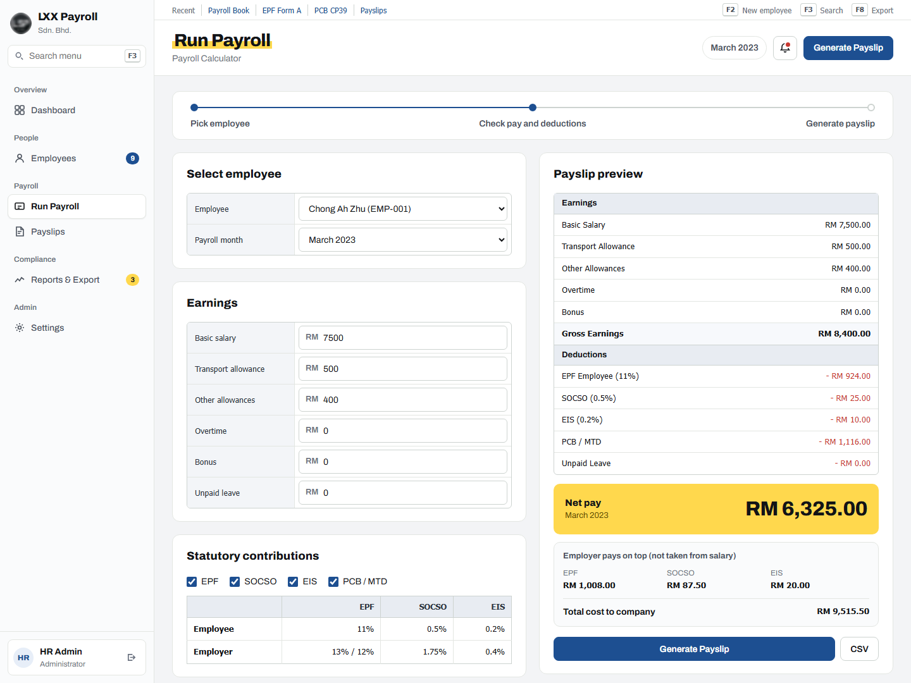
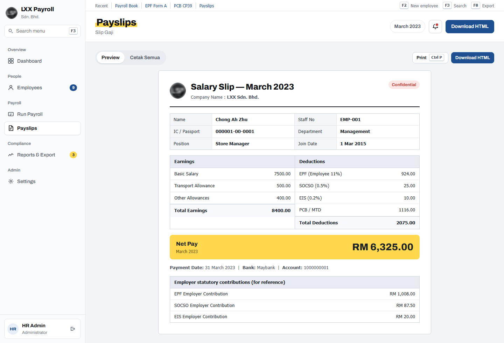
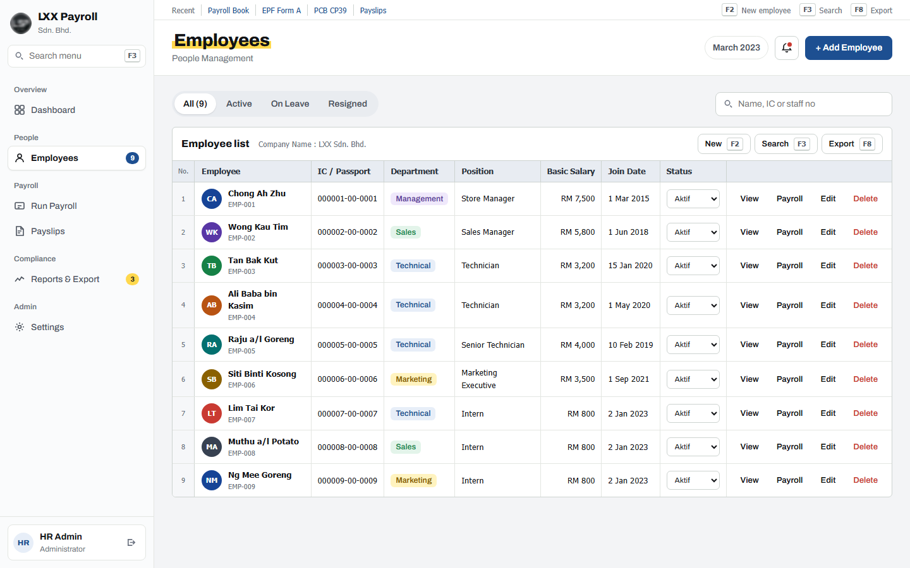
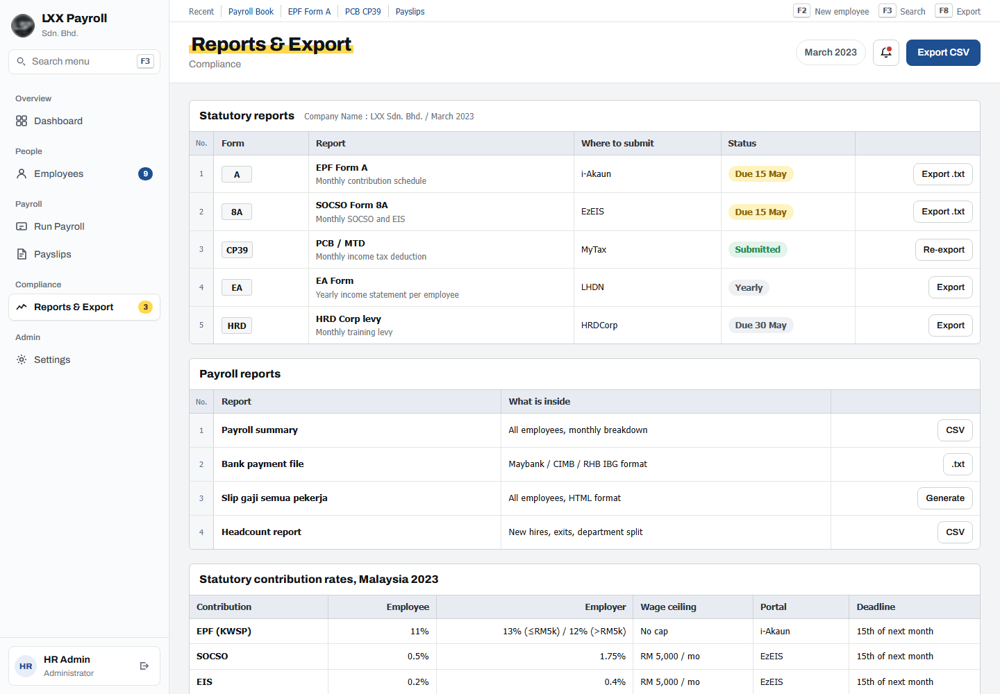

# Payroll System

A payroll system I built during my Diploma internship at a Malaysian retail company.

> To protect the privacy of the company I interned with, its name and logo have been blurred throughout this project.



## Overview

HR staff use it to keep employee records, run monthly payroll and print payslips. It works out Malaysian statutory contributions (EPF, SOCSO, EIS and PCB) and exports the files needed for submission and bank payment.

The version used at the company stored its data in MySQL. This public demo keeps the data in the browser's `localStorage` instead, so it runs without a server or database.

All employees, IC numbers and bank accounts are made-up demo data.

## Internship

| | |
|---|---|
| Programme | Diploma in Electronic Engineering (Computer) |
| Institution | Sultan Azlan Shah Polytechnic, Behrang |
| Internship period | 29 January 2024 to 14 June 2024 |

## Features

| Area | What it does |
|---|---|
| Dashboard | Headcount, gross payroll, employer cost and net pay. Payroll run status per department and upcoming submission deadlines |
| Employees | Add, edit, delete and search staff. Change status (Aktif, Cuti, Berhenti). Profile page with payroll history |
| Run Payroll | Pick an employee, adjust allowances, overtime, bonus and unpaid leave, and see the payslip update live |
| Payslips | Payslip in report layout. Print it, or download it as HTML |
| Reports | Export EPF Form A, SOCSO Form 8A + EIS and PCB CP39 as `.txt`, a bank IBG payment file and a payroll summary CSV |
| Settings | Company details, language (English, Bahasa Malaysia, Chinese) and a reset to demo data |
| Shortcuts | `F2` new employee, `F3` search, `F8` export CSV |
| Login | Admin / HR view and Employee view (employees only see their own payslip) |

## Screenshots

| Run Payroll | Payslip |
|---|---|
|  |  |

| Employees | Reports |
|---|---|
|  |  |

## Statutory rates used (2023)

| Contribution | Employee | Employer | Notes |
|---|---|---|---|
| EPF (KWSP) | 11% | 13% (basic up to RM 5,000) / 12% | No wage cap |
| SOCSO (PERKESO) | 0.5% | 1.75% | Wage capped at RM 5,000 |
| EIS (SIP) | 0.2% | 0.4% | Wage capped at RM 5,000 |
| PCB / MTD | Estimate | — | Simple yearly tax bands, not the full LHDN schedule |

PCB is an estimate for the demo. A real payroll should use the LHDN calculator or schedule.

## Technologies

- HTML, CSS and plain JavaScript, no framework and no build step
- MySQL for data in the original company version
- `localStorage` for data in this public demo
- Google Fonts (Archivo)

## Getting Started

| Step | How |
|---|---|
| Run | Open `index.html` in a browser |
| Log in | Click **Sign In** (the demo account is filled in) |
| Reset data | Settings → **Reset to demo data** |

## Directory Structure

```
Payroll System/
├── index.html          # all pages and modals
├── style.css           # layout and theme
├── app.js              # data, payroll maths, exports
└── docs/screenshots/   # images for this README
```

## Development Notes

- Payroll maths lives in `payFor()` and `calcPayroll()` in `app.js`.
- Data stays in the browser it was entered in. Clearing site data resets it.
- Forgot password and create account are demo screens only. Nothing is sent and passwords are not stored.

## Copyright

© 2024 cheah20. All rights reserved.

This project is shared for portfolio viewing only. Please do not copy, reuse or submit it as your own work. See [LICENSE](LICENSE).
